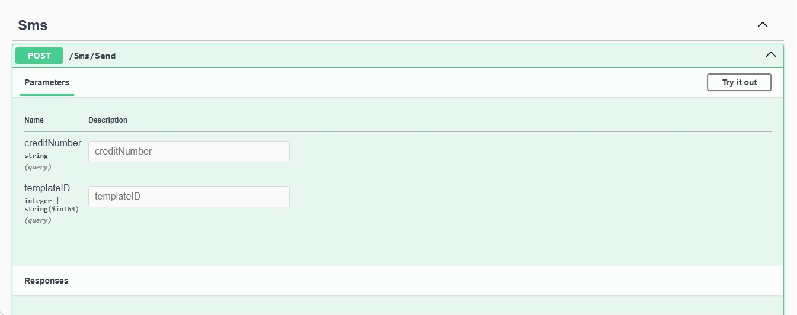

## Startup

Set `Vex.API` as startup project.

Expand `/Sms/Send` method and click `Try it out`.

`creditNumber`

1 - Customer 1 with 1000€ to pay until 1.1.2027

2 - Customer 2 with 2000€ to pay until 1.2.2027

3 - Customer 3 with 3000€ to pay until 1.3.2027

`templateID`

1 - Erinnerung

2 - Mahnung

3 - Kündigung
